# Self-organising maps of EEM data


## Introduction

staRsom is an add-on to staRdom (Pucher et al. 2019). It arranges
excitation emission matrices (EEMs) of dissolved organic matter (DOM) on
a self-organising map (SOM). You can use it to explore large and
heterogeneous data sets, to find groups of samples with similar DOM, to
find regions of the EEMs that behave alike and to identify unusual
samples (Bieroza et al. 2009; Ejarque-Gonzalez and Butturini 2014).
staRsom works with the EEMs you have corrected with staRdom, so please
do the corrections first (see the staRdom vignettes).

### Aim of this document

> This document shows a complete analysis of EEM data with a
> self-organising map, from the corrected EEMs to the interpretation of
> the map, and how the results can be used in a PARAFAC analysis.

### How a self-organising map works

You can think of a self-organising map as a grid of hexagonal cells,
called units. Each unit holds a typical EEM, its prototype. During the
training, each sample is compared with all prototypes. The most similar
prototype and, to a lesser degree, its neighbours are shifted a little
towards the sample. After many rounds, similar EEMs end up on the same
or on neighbouring units and the prototypes change gradually across the
map (Kohonen 2013). The map is a two-dimensional picture of your data
set: the position of a sample tells you what kind of EEM it has.

Unlike PARAFAC (Murphy et al. 2013), the map does not assume that the
EEMs are sums of independent components. It is therefore a good tool for
exploring the data before or besides a PARAFAC analysis. staRsom follows
the approach of Ejarque-Gonzalez and Butturini (2014):

- The EEMs are normalised, so the map shows differences in the shape of
  the EEMs, i.e. in the composition of DOM, rather than in the
  concentration.
- The prototypes are grouped by a cluster analysis to find groups of
  samples (Vesanto and Alhoniemi 2000).
- Wavelength pairs that change in the same way across the map are
  grouped into fluorescence regions.
- The stability of the map is tested by calculating it repeatedly from
  changed sample sets (Bodt et al. 2002).

Alternatively, you can arrange the loadings of a PARAFAC model on a map
(Cuss et al. 2014; Wheeler et al. 2017). The maps are calculated with
the R package kohonen (Wehrens and Kruisselbrink 2018).

### Overview of analysis steps

The diagram below shows the steps of an analysis with staRsom. After
importing and correcting the EEMs with staRdom, the EEMs are prepared
and the map is calculated. You should check the training, the quality
and the stability of the map and adjust the settings if necessary. Then
you can explore the samples on the map, find groups of samples and
fluorescence regions and check for outliers. Groups of samples can be
analysed separately with PARAFAC in staRdom, and the loadings of a
PARAFAC model can be arranged on a map as well.

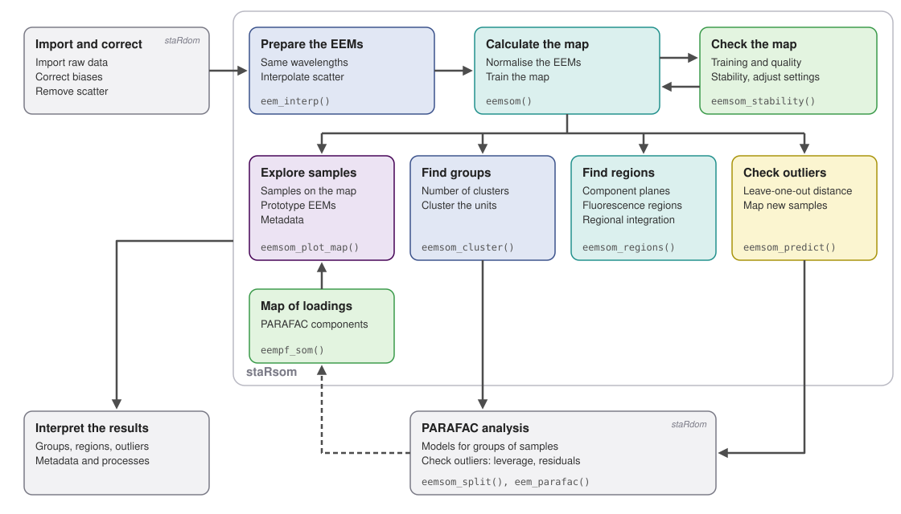

### Parallel processing

Some functions can use several CPU cores to speed up the calculations:

- [`eem_interp()`](https://rdrr.io/pkg/staRdom/man/eem_interp.html) of
  staRdom interpolates the EEMs in parallel.
- [`eemsom()`](https://matthiaspucher.github.io/staRsom/reference/eemsom.md)
  and
  [`eempf_som()`](https://matthiaspucher.github.io/staRsom/reference/eempf_som.md)
  can train the map in parallel with `mode = "pbatch"`. This parallel
  batch algorithm gives slightly different maps than the default online
  training, so please use the same `mode` if you want to reproduce your
  results.
- [`eemsom_stability()`](https://matthiaspucher.github.io/staRsom/reference/eemsom_stability.md)
  calculates the repeated maps in parallel. Its results are the same
  regardless of the number of cores.

As in staRdom, we recommend setting `cores` to the number of physical
cores of your computer:

``` r

cores <- parallel::detectCores(logical = FALSE)
```

This vignette uses 2 cores.

### Remark on warnings

Some functions show warnings when something unusual happens, e.g. when a
group of samples is too small for a PARAFAC model or when the map has
more units than samples. Warnings do not stop the calculation. Please
think about the reason of a warning; in some cases it is in line with
what you want.

``` r

library(staRsom)
data(eem_list)
data(pf_models)
```

## Load and prepare the data

### Load the drEEM example data

The drEEM tutorial data set (Murphy et al. 2013) contains 206 samples
after removing blanks and outliers. It is not part of staRdom or staRsom
because of its size, but you can download it with
[`eem_load_dreem()`](https://rdrr.io/pkg/staRdom/man/eem_load_dreem.html)
(see the staRdom vignette “PARAFAC analysis of EEM data”). The data is
already corrected. Use the following code to work with the complete data
set:

``` r

# download the drEEM data set
eem_list <- eem_load_dreem()
# remove blanks and samples that were excluded in the drEEM tutorial
eem_list <- eem_exclude(eem_list, exclude = list(sample = eem_names(eem_list)[grepl("bl|0A", eem_names(eem_list))]))
```

To keep the calculation times of this vignette short, the small subset
of 15 samples from staRdom is used below. With so few samples, the map
is very coarse and the results should not be interpreted. The code works
the same way with the complete data set.

``` r

eem_list
#>          sample ex_min ex_max em_min em_max is_blank_corrected
#> 1      d0680sfK    230    455    290    682               TRUE
#> 2       d1266sf    230    455    290    682               TRUE
#> 3      d1268sfK    230    455    290    682               TRUE
#> 4      d1543sfK    230    455    290    682               TRUE
#> 5      d1549sfK    230    455    290    682               TRUE
#> 6      d1550sfK    230    455    290    682               TRUE
#> 7      d1557sfK    230    455    290    682               TRUE
#> 8      d1559sfK    230    455    290    682               TRUE
#> 9      d1565sfK    230    455    290    682               TRUE
#> 10     d1567sfK    230    455    290    682               TRUE
#> 11     d1568sfK    230    455    290    682               TRUE
#> 12       d492sf    230    455    290    682               TRUE
#> 13       d661sf    230    455    290    682               TRUE
#> 14       d667sf    230    455    290    682               TRUE
#> 15 dSFB445pwd1t    230    455    290    682               TRUE
#>    is_scatter_corrected is_ife_corrected is_raman_normalized
#> 1                 FALSE             TRUE                TRUE
#> 2                 FALSE             TRUE                TRUE
#> 3                 FALSE             TRUE                TRUE
#> 4                 FALSE             TRUE                TRUE
#> 5                 FALSE             TRUE                TRUE
#> 6                 FALSE             TRUE                TRUE
#> 7                 FALSE             TRUE                TRUE
#> 8                 FALSE             TRUE                TRUE
#> 9                 FALSE             TRUE                TRUE
#> 10                FALSE             TRUE                TRUE
#> 11                FALSE             TRUE                TRUE
#> 12                FALSE             TRUE                TRUE
#> 13                FALSE             TRUE                TRUE
#> 14                FALSE             TRUE                TRUE
#> 15                FALSE             TRUE                TRUE
```

### Prepare the EEMs

All EEMs need the same excitation and emission wavelengths. We recommend
removing and interpolating scattering as in a PARAFAC analysis,
otherwise Raman and Rayleigh scattering would dominate the map. Here,
the wavelengths are additionally reduced to the range of the PARAFAC
model `pf4` from staRdom. These staRdom functions are useful at this
step:

- [`eem_range()`](https://rdrr.io/pkg/staRdom/man/eem_range.html) cuts
  the EEMs to a range of wavelengths.
- [`eem_red2smallest()`](https://rdrr.io/pkg/staRdom/man/eem_red2smallest.html)
  and
  [`eem_extend2largest()`](https://rdrr.io/pkg/staRdom/man/eem_extend2largest.html)
  bring EEMs with different wavelengths to the same wavelengths.
- [`eem_rem_scat()`](https://rdrr.io/pkg/staRdom/man/eem_rem_scat.html)
  removes scattering,
  [`eem_interp()`](https://rdrr.io/pkg/staRdom/man/eem_interp.html)
  interpolates the removed areas.
- [`eem_exclude()`](https://rdrr.io/pkg/staRdom/man/eem_exclude.html)
  removes samples or wavelengths.

``` r

eem_list <- eem_list |>
  # same wavelength range as the PARAFAC model pf4
  eem_range(ex = c(250, 455), em = c(290, 578)) |>
  # remove Raman and Rayleigh scattering of 1st and 2nd order
  eem_rem_scat(remove_scatter = c(TRUE, TRUE, TRUE, TRUE), remove_scatter_width = c(15, 15, 18, 19)) |>
  # interpolate the removed areas
  eem_interp(type = 1, extend = FALSE, cores = cores)
ggeem(eem_list)
```

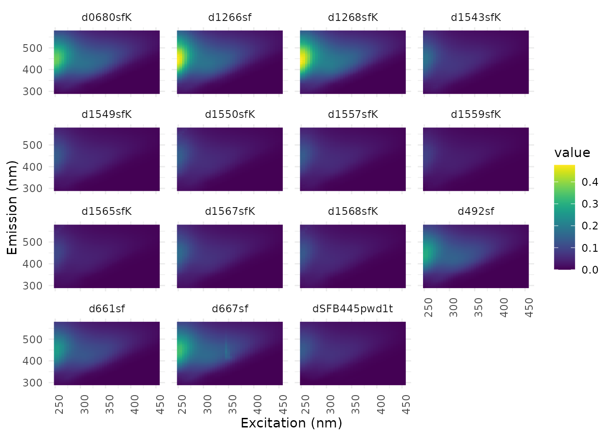

## Calculate the map

### Train the map

[`eemsom()`](https://matthiaspucher.github.io/staRsom/reference/eemsom.md)
normalises the EEMs and trains the map. By default, each EEM is divided
by its standard deviation, like `eem_parafac(normalise = TRUE)` does, so
the map shows differences in the composition of DOM. You can use
`normalise = "max"` to divide by the maximum as Ejarque-Gonzalez and
Butturini (2014) did, or `normalise = "none"` if differences in
concentration are of interest. The size of the map is chosen
automatically from the number of samples (Vesanto and Alhoniemi 2000),
but you can set it with `dim`. Please always set a `seed` to get the
same map again. Without `seed`, the functions use the random numbers of
your R session like other R functions do, so
[`set.seed()`](https://rdrr.io/r/base/Random.html) before the call works
as well.

``` r

# train the map, the seed makes the result reproducible
som <- eemsom(eem_list, seed = 42, verbose = TRUE)
#> A map of 3 x 5 units is calculated from 15 samples and 3066 wavelength pairs.
som
#> Self-organising map of 15 EEMs
#>  map: 3 x 5 hexagonal units
#>  wavelength pairs: 3066 of 3066 
#>  normalisation: sd 
#>  clusters: none
```

### Check the training and the quality

The training should end with a flat curve. If the curve still decreases
at the end, please increase the number of training rounds `rlen`.

``` r

eemsom_plot_training(som)
```

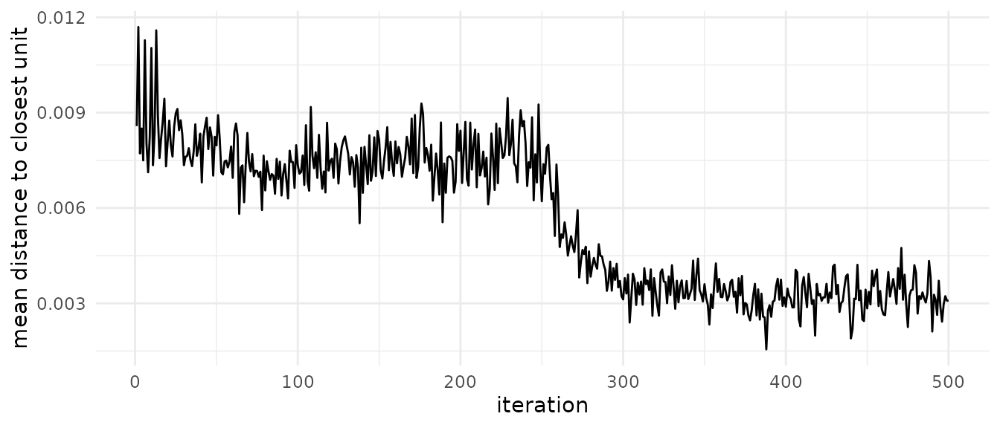

[`eemsom_quality()`](https://matthiaspucher.github.io/staRsom/reference/eemsom_quality.md)
describes how well the map represents your samples:

- The quantisation error is the mean distance between the samples and
  their prototypes. Lower values mean that the prototypes represent the
  samples well.
- The topographic error is the share of samples whose two most similar
  prototypes are not neighbours. High values indicate a folded map, on
  which similar samples are spread over distant units.
- The explained variance is the share of the differences between the
  samples that is represented by the prototypes.

``` r

eemsom_quality(som)
#>   quantisation_error topographic_error explained_variance
#> 1          0.5102973                 0          0.9748979
```

### Speed up the calculation for large data sets

With the 15 samples used here, every step takes seconds. The training
time grows with the numbers of samples, units and wavelength pairs: the
default online training with `rlen = 500` takes about a minute for 200
EEMs with 3000 wavelength pairs and several minutes for 1000 EEMs on one
core. The stability test below repeats the training `nrep` times. To
reduce the time, you can use the parallel batch training, fewer training
rounds or a lower resolution of the EEMs. Ejarque-Gonzalez and Butturini
(2014) used 366 wavelength pairs.

``` r

# parallel batch training with 4 cores and fewer training rounds
som_pbatch <- eemsom(eem_list, mode = "pbatch", cores = 4, rlen = 100, seed = 42)
# lower resolution: remove every second excitation and emission wavelength
eem_list_reduced <- eem_exclude(eem_list, list(ex = eem_list[[1]]$ex[c(FALSE, TRUE)], em = eem_list[[1]]$em[c(FALSE, TRUE)]))
```

## Explore the samples on the map

These functions show where the samples are and what the map looks like:

- [`eemsom_samples()`](https://matthiaspucher.github.io/staRsom/reference/eemsom_samples.md)
  returns the unit of each sample, its distance to the prototype, the
  number of samples on the unit (`hits`) and the U-matrix value of the
  unit (see below).
- [`eemsom_plot_map()`](https://matthiaspucher.github.io/staRsom/reference/eemsom_plot_map.md)
  shows different properties of the units and the samples on the map.
- [`ggeem()`](https://rdrr.io/pkg/staRdom/man/ggeem.html) plots the
  prototype EEMs,
  [`eemsom_codes()`](https://matthiaspucher.github.io/staRsom/reference/eemsom_codes.md)
  returns them as an eemlist, e.g. for an export.
- [`eemsom_plot_cplane()`](https://matthiaspucher.github.io/staRsom/reference/eemsom_plot_cplane.md)
  shows the fluorescence of single wavelength pairs on the map.

### Locate the samples

``` r

eemsom_samples(som)
#>          sample unit   x         y    distance hits  umatrix cluster
#> 1      d0680sfK    2 2.5 0.8660254 0.771242410    2 2.862827      NA
#> 2       d1266sf    4 1.0 1.7320508 0.028420309    1 5.733483      NA
#> 3      d1268sfK    1 1.5 0.8660254 0.009557136    1 3.580341      NA
#> 4      d1543sfK   13 1.5 4.3301270 0.014728140    1 2.112330      NA
#> 5      d1549sfK    7 1.5 2.5980762 0.005551173    1 3.655032      NA
#> 6      d1550sfK   15 3.5 4.3301270 0.784240716    2 2.192876      NA
#> 7      d1557sfK   11 2.0 3.4641016 0.783183569    2 2.213011      NA
#> 8      d1559sfK   11 2.0 3.4641016 0.948463561    2 2.213011      NA
#> 9      d1565sfK   12 3.0 3.4641016 0.003686166    1 2.601416      NA
#> 10     d1567sfK   10 1.0 3.4641016 0.006334259    1 1.969990      NA
#> 11     d1568sfK   15 3.5 4.3301270 0.803437383    2 2.192876      NA
#> 12       d492sf    6 3.0 1.7320508 1.153566108    2 3.054202      NA
#> 13       d661sf    2 2.5 0.8660254 1.001773220    2 2.862827      NA
#> 14       d667sf    6 3.0 1.7320508 1.325074451    2 3.054202      NA
#> 15 dSFB445pwd1t    3 3.5 0.8660254 0.015201577    1 3.392289      NA
```

The number of samples per unit shows how the samples are distributed.
`unit_labels = TRUE` adds the numbers of the units, which are used in
the other functions. The U-matrix shows how different each prototype is
from its neighbours. High values mark borders between groups of similar
units, low values indicate regions of similar units (Ejarque-Gonzalez
and Butturini 2014).

``` r

eemsom_plot_map(som, type = "counts", unit_labels = TRUE)
eemsom_plot_map(som, type = "umatrix")
```

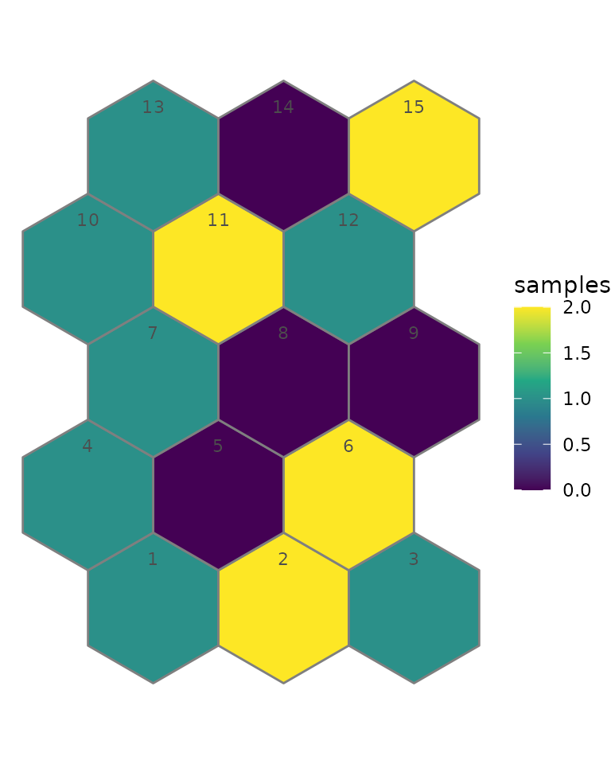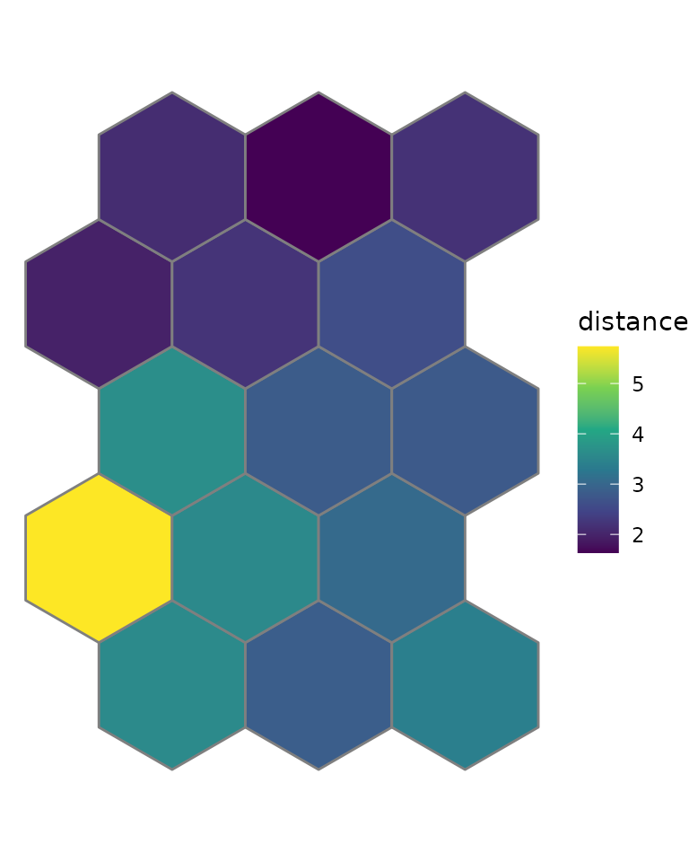

You can colour the samples by metadata, e.g. sampling site, date or
discharge. Ejarque-Gonzalez and Butturini (2014) showed in this way that
samples taken during floods along the whole river were mapped to a few
neighbouring units, i.e. floods made the EEMs more similar. Here, we use
the first letters of the sample names as an example.

``` r

# one value per sample, in the order of the samples in eem_list
site <- substr(eem_names(eem_list), 1, 3)
eemsom_plot_map(som, type = "samples", colour = site, labels = TRUE)
```

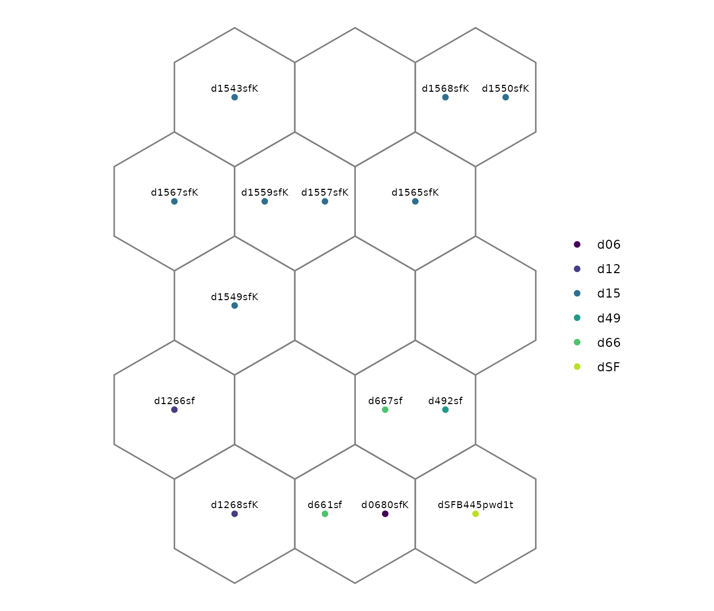

### View the prototype EEMs

The prototypes are arranged like the units on the map. The titles show
the number of samples on each unit. The prototypes show the typical
fluorescence of each part of the map (Ejarque-Gonzalez and Butturini
2014), so you can see how the EEMs change from one side of the map to
the other.

``` r

ggeem(som)
```

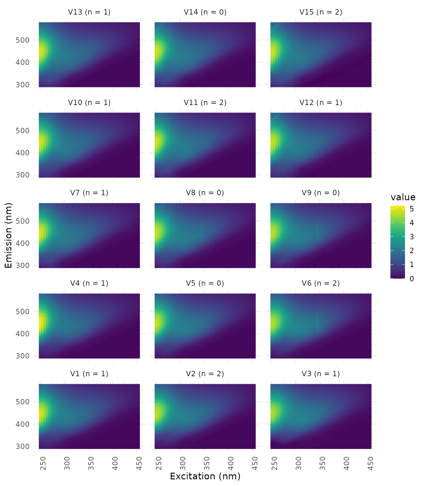

### Look at single wavelength pairs

A component plane shows the fluorescence of one wavelength pair in all
prototypes. Wavelength pairs with similar component planes change in the
same way across your samples, which is the basis of the fluorescence
regions below (Ejarque-Gonzalez and Butturini 2014). Here, we look at
the peaks B, T, A and C (Coble 1996). With one colour scale for all
planes, you can compare the intensities:

``` r

# peaks B, T, A and C, the closest available wavelengths are used
eemsom_plot_cplane(som, ex = c(275, 275, 260, 350), em = c(310, 340, 450, 450))
```

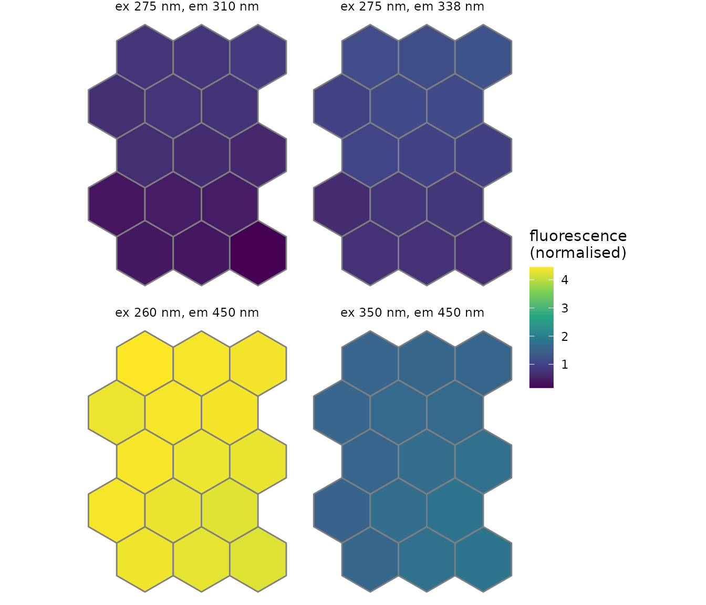

Scaling each plane from 0 to 1 shows the patterns of weak peaks as well:

``` r

eemsom_plot_cplane(som, ex = c(275, 275, 260, 350), em = c(310, 340, 450, 450), scale = "each")
```

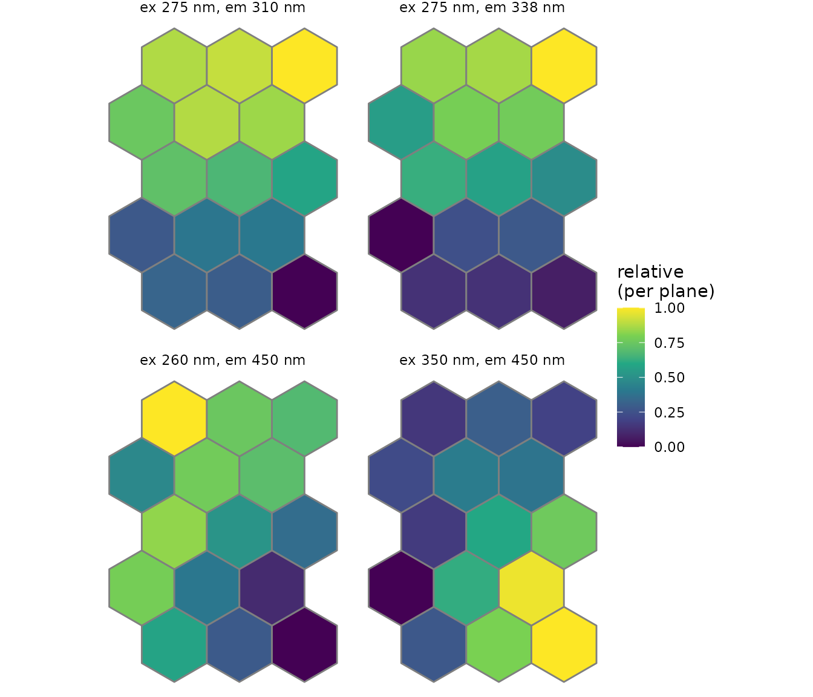

## Find groups of samples

The prototypes are grouped by a hierarchical cluster analysis with
complete linkage (Ejarque-Gonzalez and Butturini 2014). Each sample
belongs to the cluster of its unit. These functions are used:

- [`eemsom_kselect()`](https://matthiaspucher.github.io/staRsom/reference/eemsom_kselect.md)
  helps you to choose the number of clusters.
- [`eemsom_cluster()`](https://matthiaspucher.github.io/staRsom/reference/eemsom_cluster.md)
  clusters the units.
- [`eemsom_plot_silhouette()`](https://matthiaspucher.github.io/staRsom/reference/eemsom_plot_silhouette.md)
  shows how well each unit fits into its cluster.
- `eemsom_plot_map(type = "cluster")` shows the clusters on the map.

### Choose the number of clusters

[`eemsom_kselect()`](https://matthiaspucher.github.io/staRsom/reference/eemsom_kselect.md)
calculates several criteria for different numbers of clusters. Good
numbers have a high mean silhouette width (Rousseeuw 1987), few units
with negative silhouette widths (units that would fit better into
another cluster), a low Davies-Bouldin index and are at a bend of the
decreasing within-cluster sum of squares. The criteria do not always
agree, so please also consider what makes sense for your samples.

``` r

eemsom_kselect(som, k = 2:8)
#>   k silhouette negative davies_bouldin       wss
#> 1 2  0.4357773        1      0.7746592 111.83557
#> 2 3  0.4364312        2      0.5583570  67.90585
#> 3 4  0.3566238        0      0.7263544  42.44332
#> 4 5  0.3500087        0      0.5863359  31.36231
#> 5 6  0.2427718        1      0.5788073  25.38621
#> 6 7  0.2316670        2      0.5233509  18.34812
#> 7 8  0.2468078        1      0.6136547  12.34566
```

### Cluster the units

The silhouette width shows how well each unit fits into its cluster.
Ejarque-Gonzalez and Butturini (2014) chose the number of fluorescence
regions by a high mean silhouette width and few negative values.

``` r

# three clusters, complete linkage by default
som <- eemsom_cluster(som, k = 3)
eemsom_plot_map(som, type = "cluster")
eemsom_plot_silhouette(som)
```

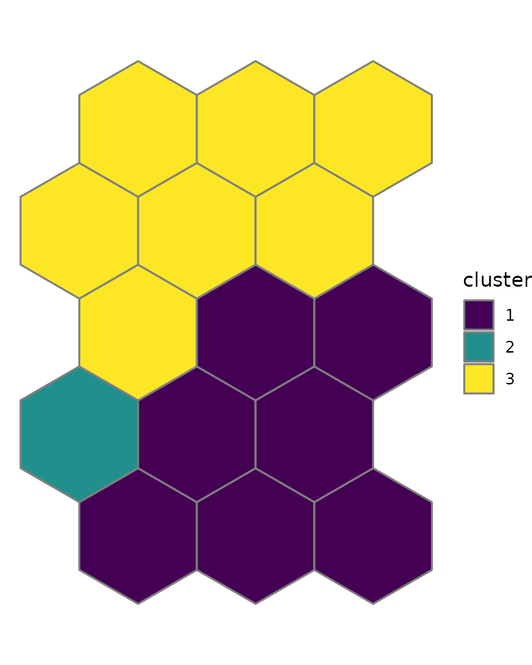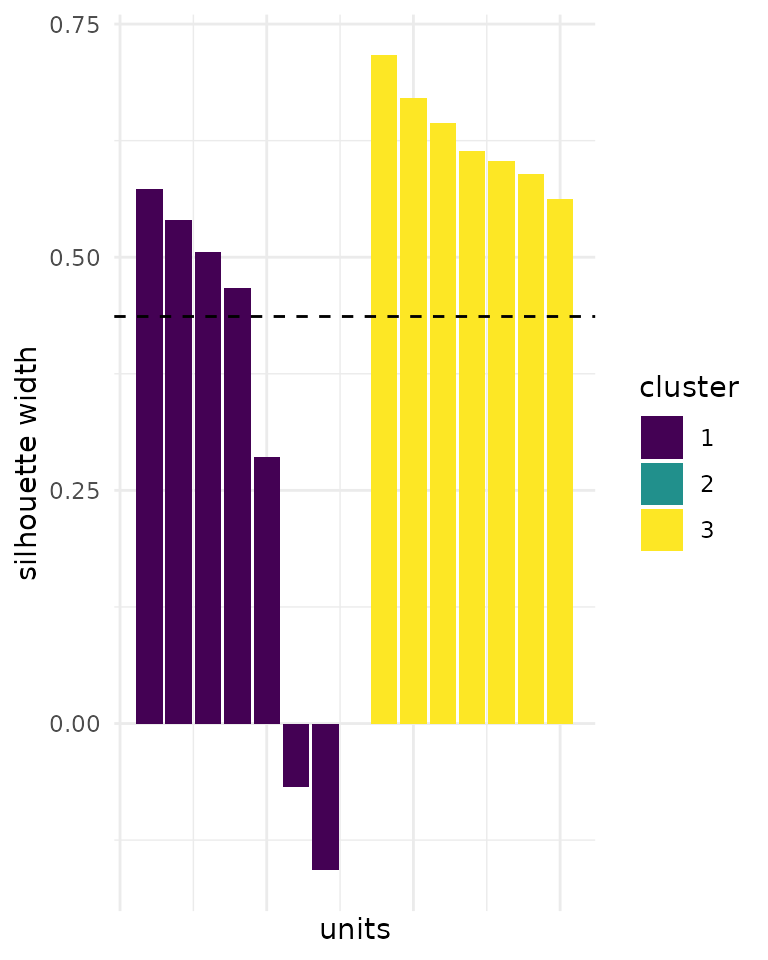

``` r

# number of samples per cluster
table(cluster = eemsom_samples(som)$cluster)
#> cluster
#> 1 2 3 
#> 6 1 8
```

## Find fluorescence regions

Wavelength pairs whose component planes are correlated change in the
same way across your samples.
[`eemsom_regions()`](https://matthiaspucher.github.io/staRsom/reference/eemsom_regions.md)
groups them into regions, and each region is assumed to represent a
fluorescence component (Ejarque-Gonzalez and Butturini 2014). By
default, the number of regions is chosen from 2 to 9 by the highest mean
silhouette width; you can also set a single number with `k`. The default
`method = "planes"` is a fast alternative to the correlation matrix used
by Barreto-Sanz and Pérez-Uribe (2007) (`method = "cormat"`). These
functions are used:

- [`eemsom_regions()`](https://matthiaspucher.github.io/staRsom/reference/eemsom_regions.md)
  finds the regions.
- [`ggeem()`](https://rdrr.io/pkg/staRdom/man/ggeem.html) plots the
  regions.
- [`eemsom_fri()`](https://matthiaspucher.github.io/staRsom/reference/eemsom_fri.md)
  integrates the fluorescence of each sample within the regions.

``` r

regions <- eemsom_regions(som, seed = 42)
regions
#> Fluorescence regions from a self-organising map
#>  regions: 2 (highest mean silhouette) 
#>  wavelength pairs per region:
#> region
#>    1    2 <NA> 
#> 2323  656   87
# criteria for the numbers of regions
regions$kselect
#>   k silhouette negative davies_bouldin      wss
#> 1 2  0.4917579        4      0.8856574 91.17789
#> 2 3  0.4852490       13      0.7061162 74.97346
#> 3 4  0.3650833       15      1.0171283 55.20362
#> 4 5  0.3234194       23      1.1053236 52.33315
#> 5 6  0.2156770       34      1.3643238 47.98234
#> 6 7  0.2044633       54      1.1305220 43.80484
#> 7 8  0.2038195       55      1.0821254 42.12985
#> 8 9  0.2155809       53      1.0368387 39.59634
ggeem(regions)
```

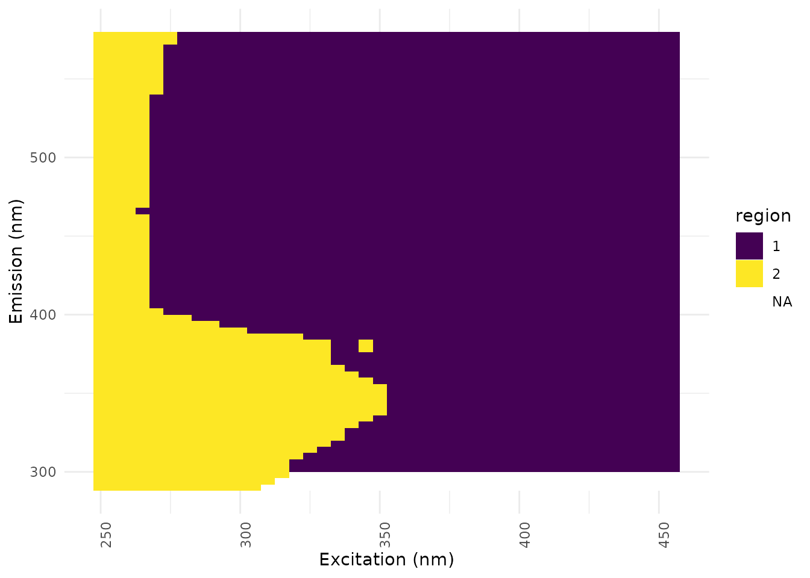

The fluorescence of each sample can be integrated within the regions
(Chen et al. 2003). Ejarque-Gonzalez and Butturini (2014) used these
area-normalised volumes as new variables to describe their samples. They
describe your samples independently of a PARAFAC model.

``` r

fri <- eemsom_fri(eem_list, regions)
fri
#>          sample  region_1 region_2
#> 1      d0680sfK 3938.5736 6963.183
#> 2       d1266sf 3990.8125 8243.682
#> 3      d1268sfK 4515.7783 8813.097
#> 4      d1543sfK 1653.3650 3681.542
#> 5      d1549sfK 1289.5365 2760.938
#> 6      d1550sfK 1339.3196 3031.985
#> 7      d1557sfK 1327.6508 2805.020
#> 8      d1559sfK  892.8317 1890.083
#> 9      d1565sfK 1005.4162 2157.666
#> 10     d1567sfK 1569.4688 3382.323
#> 11     d1568sfK 1242.6781 2837.570
#> 12       d492sf 3163.3834 5731.908
#> 13       d661sf 2809.7332 5099.070
#> 14       d667sf 3585.2609 6487.747
#> 15 dSFB445pwd1t 1493.2018 2509.748
```

## Check the stability of the map

Before you interpret the map, please check whether it is stable.
[`eemsom_stability()`](https://matthiaspucher.github.io/staRsom/reference/eemsom_stability.md)
calculates the map again from changed sample sets with the settings of
`som`: from bootstrap samples, i.e. samples drawn randomly with
replacement (Bodt et al. 2002), or from all samples but one
(leave-one-out, `type = "loo"`) (Ejarque-Gonzalez and Butturini 2014).
On a stable map, pairs of samples are almost always or almost never
neighbours, while a random map produces a bell-shaped distribution
(compare Figure 4B in Ejarque-Gonzalez and Butturini (2014)). More
repetitions (`nrep`) give more reliable results. Each repetition trains
a new map, so please consider the advice on calculation times above.

``` r

# 10 maps from bootstrap samples, calculated in parallel
stab <- eemsom_stability(eem_list, som, nrep = 10, seed = 42, cores = cores)
stab
#> Stability of a self-organising map (bootstrap, 10 maps)
#>  SS intra: mean 49.65, median 34.24, CV 77.5 %
#>  neighbourhood (radius 1): pairs always or never neighbours: 52.4 %
#>    expected on a random map: 1.74 %
eemsom_plot_stability(stab)
```

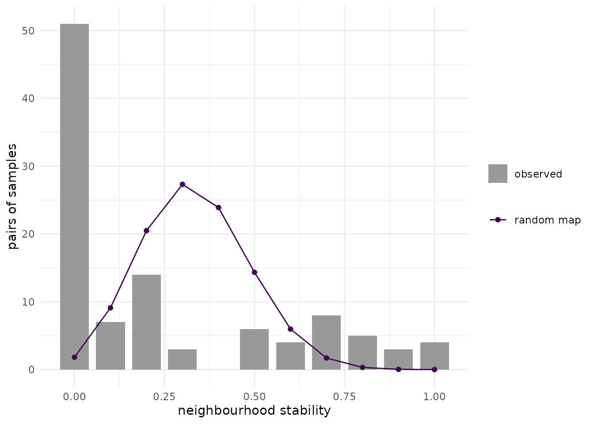

## Check for outliers

### Keep outliers in the map

In a PARAFAC analysis, outliers are removed, because a few unusual
samples can distort all components of the model (Murphy et al. 2013).
Self-organising maps are less sensitive: each unit has its own prototype
and an unusual sample usually occupies a unit of its own without
changing the rest of the map. Ejarque-Gonzalez and Butturini (2014) kept
their outliers and found them “naturally integrated” in the map;
industrial effluents formed clusters of single units, and leaving them
out did not change the map in a meaningful way. Moreover, unusual
samples are often an interesting result of an exploratory analysis.
Therefore, we recommend keeping outliers in the map. Only samples with
errors, e.g. measurement artefacts or remaining scatter, should be
removed before.

### Find candidates for outliers

The map gives you hints on samples that might be outliers in a
subsequent PARAFAC analysis. Here, the two samples excluded by staRdom
from the drEEM data are added to the example data:

``` r

# the two samples excluded by staRdom, prepared like the example data
data(eem_list_outliers)
eem_list_outliers <- eem_list_outliers |>
  eem_rem_scat(remove_scatter = c(TRUE, TRUE, TRUE, TRUE), remove_scatter_width = c(15, 15, 18, 19)) |>
  eem_interp(type = 1, extend = FALSE, cores = cores)
# example data and the two outliers together
eem_all <- eem_bind(eem_list, eem_list_outliers)
som_all <- eemsom(eem_all, seed = 42)
smp <- eemsom_samples(som_all)
```

Unusual samples often occupy a unit alone (`hits` = 1) that is separated
from the neighbouring units by a high U-matrix value. Their distance to
the prototype can be small though, because the prototype adapts to them.
A more reliable indicator is the leave-one-out distance: each sample is
compared with a map calculated without it. This is similar to the
residuals of a sample that is not part of a PARAFAC model.
[`eemsom_stability()`](https://matthiaspucher.github.io/staRsom/reference/eemsom_stability.md)
with `type = "loo"` calculates these maps and returns the distances in
the element `loo`.

``` r

# one map without each sample
loo <- eemsom_stability(eem_all, som_all, type = "loo", nrep = 1, seed = 42, cores = cores)
loo
#> Stability of a self-organising map (loo, 17 maps)
#>  SS intra: mean 29.17, median 21.33, CV 91.4 %
#>  neighbourhood (radius 1): pairs always or never neighbours: 62.5 %
#>    expected on a random map: 0.101 %
#>  leave-one-out distance: median 2.06, highest: dsgb447wt (10.5), dsfb676psp (6.74), d1266sf (4.18)
```

The table compares these indicators with the leverage of the samples in
the PARAFAC model `pf2[[4]]` from staRdom, which contains all drEEM
samples including the two outliers.

``` r

outliers <- data.frame(smp[, c("sample", "hits", "umatrix", "distance")],
                       loo = loo$loo$distance,
                       leverage = unname(eempf_leverage(pf2[[4]])$A[smp$sample]))
# samples with the highest leave-one-out distances first
outliers[order(-outliers$loo), ]
#>          sample hits  umatrix     distance       loo    leverage
#> 17    dsgb447wt    1 8.934185 5.256213e-05 10.546329 0.255833824
#> 16   dsfb676psp    1 6.677372 3.145646e-02  6.737005 0.492049700
#> 2       d1266sf    1 5.950210 3.577513e-02  4.178690 0.054794259
#> 15 dSFB445pwd1t    2 3.383682 1.589975e+00  3.296709 0.027049407
#> 14       d667sf    2 3.084430 1.292229e+00  2.627484 0.008442645
#> 1      d0680sfK    2 3.383682 1.387496e+00  2.273111 0.022720516
#> 8      d1559sfK    3 3.193206 9.942251e-01  2.175092 0.044673236
#> 12       d492sf    2 3.084430 1.186411e+00  2.100840 0.021094503
#> 11     d1568sfK    2 3.407745 7.346634e-01  2.061624 0.035026290
#> 3      d1268sfK    1 4.810965 8.149586e-03  2.031744 0.012316334
#> 9      d1565sfK    3 3.193206 1.449191e+00  2.006733 0.024740826
#> 4      d1543sfK    1 2.270074 1.329147e-02  1.800444 0.020185157
#> 7      d1557sfK    3 3.193206 1.063233e+00  1.635923 0.034074904
#> 5      d1549sfK    2 3.759363 8.068933e-01  1.563331 0.015881803
#> 10     d1567sfK    2 3.759363 7.657490e-01  1.512970 0.017397401
#> 6      d1550sfK    2 3.407745 8.530147e-01  1.440138 0.030277456
#> 13       d661sf    1 3.594859 6.307489e-03  1.290998 0.009985019
```

``` r

eemsom_plot_map(som_all, type = "samples", colour = loo$loo$distance, labels = TRUE)
```

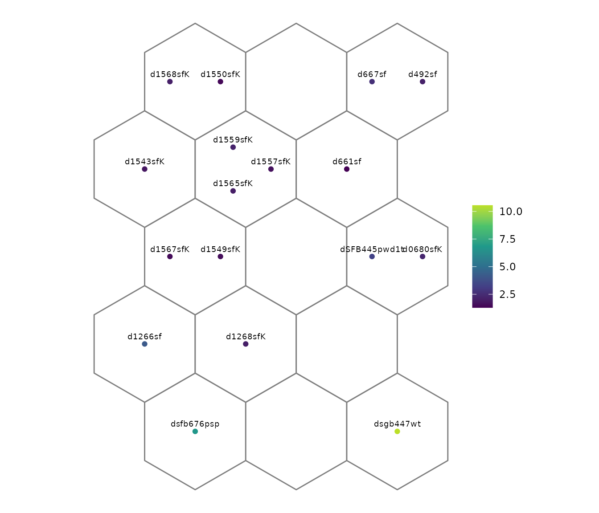

The samples with the highest leave-one-out distances, dsgb447wt and
dsfb676psp, are the two outliers. In the complete drEEM data set (208
samples including the two outliers, default settings), both samples
occupied units of their own and had the highest leave-one-out distances
(9.9 and 7.3, median of all samples 1.0, next sample 3.6) as well as the
highest leverages in the PARAFAC model (0.49 and 0.26, next sample
0.08).

### Check the candidates in PARAFAC

The indicators of the map point to samples with an unusual shape of
their EEMs. They do not replace the outlier analysis of the PARAFAC
model:

- The leverage describes the influence of a sample on the PARAFAC model,
  the residuals describe how well the model represents the sample. The
  map cannot distinguish between both cases.
- Across all samples of the drEEM data, the indicators of the map were
  only moderately correlated with leverage and residuals (Spearman’s
  correlation 0.37 to 0.54). The most extreme samples agreed, but not
  the order of the others.
- Samples that differ only in concentration are not detected, because
  the EEMs are normalised (unless `normalise = "none"`).

Please check samples with distinctly high leave-one-out distances with
[`eempf_leverage_plot()`](https://rdrr.io/pkg/staRdom/man/eempf_leverage_plot.html)
and
[`eempf_residuals_plot()`](https://rdrr.io/pkg/staRdom/man/eempf_residuals_plot.html)
of staRdom before you exclude them. Groups of single outliers created by
[`eemsom_split()`](https://matthiaspucher.github.io/staRsom/reference/eemsom_split.md)
are too small for a PARAFAC model anyway.

## Continue the analysis

### Calculate PARAFAC models for groups of samples

You can analyse groups of samples separately with PARAFAC.
[`eemsom_split()`](https://matthiaspucher.github.io/staRsom/reference/eemsom_split.md)
returns one eemlist per cluster. A warning is shown for groups with less
than `min_samples` samples, because PARAFAC models need a sufficient
number of samples. Please validate the PARAFAC model of each group as
usual (Murphy et al. 2013).

``` r

# one eemlist per cluster
eem_groups <- eemsom_split(eem_list, som, min_samples = 5)
#> Warning in eemsom_split(eem_list, som, min_samples = 5): The following groups
#> contain less than 5 samples, PARAFAC models might not be stable: cluster_2
lengths(eem_groups)
#> cluster_1 cluster_2 cluster_3 
#>         6         1         8
```

``` r

# one set of PARAFAC models per group
pf_groups <- lapply(eem_groups, eem_parafac, comps = 3:6, normalise = TRUE, nstart = 25, cores = cores)
```

### Map new samples

You can map new samples to an existing map, e.g. for monitoring. They
need the same wavelengths and the same preparation as the samples of the
map. Here, we use the two samples staRdom excluded as outliers from the
drEEM data, which were prepared above.

``` r

pred <- eemsom_predict(som, eem_list_outliers)
pred
#>       sample unit   x         y  distance hits  umatrix cluster
#> 1 dsfb676psp    4 1.0 1.7320508  6.742645    1 5.733483       2
#> 2  dsgb447wt    3 3.5 0.8660254 10.542055    1 3.392289       1
```

A high distance compared to the samples of the map indicates that a
sample is not well represented by the map. The distances of the two
outliers (6.7 and 10.5) are much higher than those of the samples used
to calculate the map (maximum 1.3).

## Calculate a map of PARAFAC loadings

Instead of the EEMs, you can arrange the loadings of a PARAFAC model on
a map. Cuss et al. (2014) found a clearer separation of DOM sources with
the relative contributions of the components than with the EEMs.
[`eempf_som()`](https://matthiaspucher.github.io/staRsom/reference/eempf_som.md)
uses the Fmax values of each component, divided by their sum per sample
(`normalise = TRUE`). Here, we use the six-component model of the
complete drEEM data set from staRdom.

``` r

# map of the relative contributions of the PARAFAC components
pfsom <- eempf_som(pf4[[1]], seed = 42)
pfsom
#> Self-organising map of 206 samples from a PARAFAC model with 6 components
#>  map: 5 x 14 hexagonal units
#>  loadings: relative (Fmax / sum of Fmax) 
#>  clusters: none
eemsom_quality(pfsom)
#>   quantisation_error topographic_error explained_variance
#> 1        0.006747389         0.1165049          0.9918021
```

The component planes show the relative contribution of each PARAFAC
component. Each plane is scaled individually to show the patterns of all
components.

``` r

eemsom_plot_cplane(pfsom, scale = "each")
```

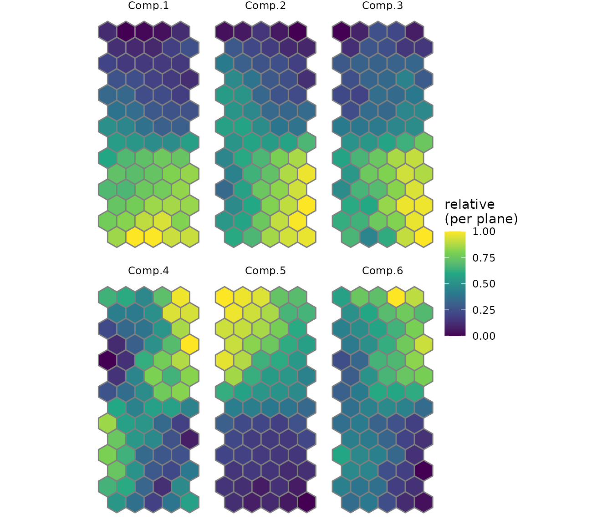

You can use the functions for clustering, splitting and plotting as for
maps of EEMs. The prototype EEMs are calculated from the PARAFAC
components.

``` r

eemsom_kselect(pfsom, k = 2:8)
#>   k silhouette negative davies_bouldin        wss
#> 1 2  0.5743290        6      0.5543878 0.13164369
#> 2 3  0.4856162        2      0.8028756 0.07916566
#> 3 4  0.4427655        5      0.7551009 0.06861223
#> 4 5  0.4419091        3      0.7561847 0.04820704
#> 5 6  0.3791600        4      0.8160423 0.03599942
#> 6 7  0.3861208        2      0.7934158 0.03122034
#> 7 8  0.3816377        2      0.7732011 0.02650249
pfsom <- eemsom_cluster(pfsom, k = 4)
eemsom_plot_map(pfsom, type = "cluster")
eemsom_plot_map(pfsom, type = "counts")
```

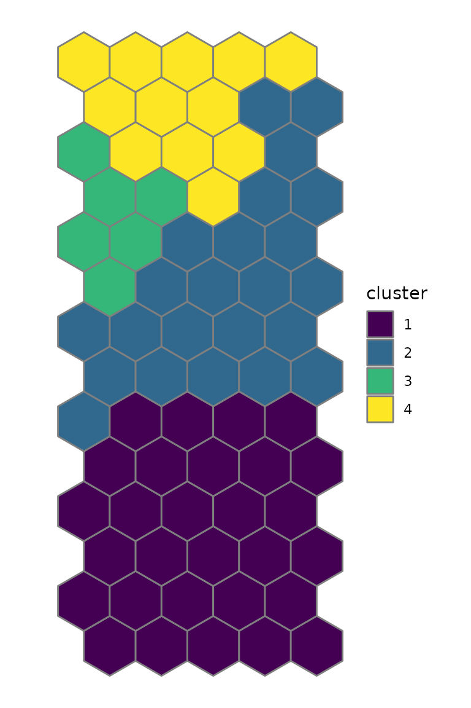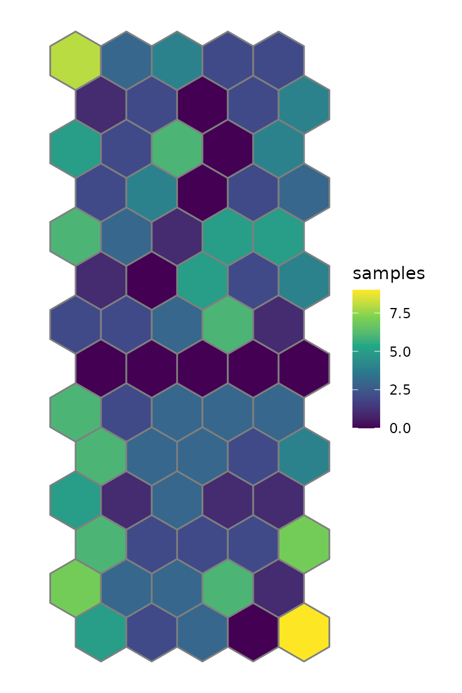

``` r

# prototypes of one unit per cluster
units <- which(!duplicated(pfsom$clusters))
ggeem(pfsom, units = units)
```

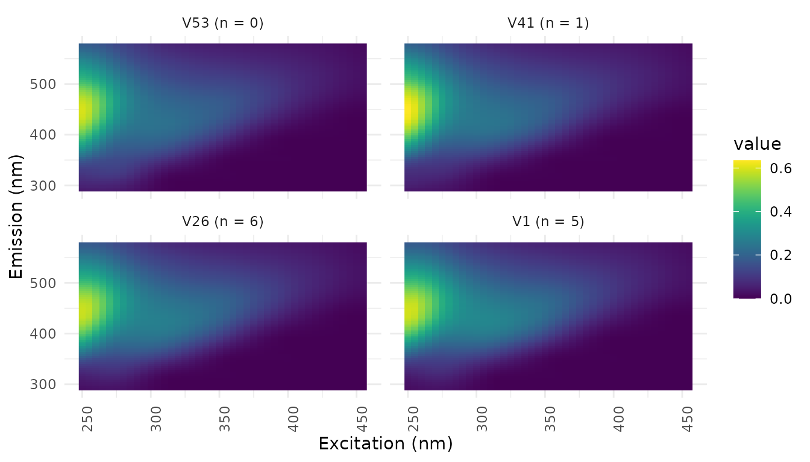

New samples are mapped after their loadings have been calculated with
the emission and excitation loadings of the PARAFAC model
([`A_missing()`](https://rdrr.io/pkg/staRdom/man/A_missing.html) of
staRdom). They need the same preparation as the EEMs of the model. Here,
the two outliers prepared above are used.

``` r

eemsom_predict(pfsom, eem_list_outliers)
#>       sample unit   x        y   distance hits    umatrix cluster
#> 1 dsfb676psp   46 1.0 8.660254 0.05968739    6 0.02195957       3
#> 2  dsgb447wt   25 5.5 4.330127 0.05249007    4 0.01781043       1
```

## Interpret the map

These points help you to read the map:

- **Position:** Samples close to each other on the map have similar
  EEMs. Distances on the map are only meaningful between neighbouring
  units; distant units can be similar if the map is folded.
- **U-matrix:** High values mark borders between groups of similar
  units. Groups of units with low values contain similar prototypes.
- **Counts and empty units:** Empty units lie between groups of samples
  and show transitions between them. Many samples on one unit indicate a
  homogeneous group.
- **Single units with high U-matrix values:** Samples with very
  distinctive EEMs can form clusters of a single unit, e.g. industrial
  effluents in Ejarque-Gonzalez and Butturini (2014). Such outliers are
  integrated in the map without distorting it, which you can check with
  the stability test. High leave-one-out distances confirm them as
  candidates for outliers in a PARAFAC analysis (see “Check for
  outliers”).
- **Prototypes:** The prototype EEMs show the typical fluorescence of
  each part of the map. You can read the differences between clusters
  from their prototypes.
- **Component planes:** Similar component planes indicate fluorescence
  that changes in the same way. Gradients of peaks along the map explain
  the arrangement of the samples. The regions summarise these patterns.
- **Metadata:** Colouring the samples by metadata shows whether groups
  on the map correspond to sites, seasons, hydrological conditions or
  other factors.
- **Stability:** Please draw conclusions only from stable maps. Check
  the quality measures and the stability before you interpret single
  units.

## References

Barreto-Sanz, Miguel A., and Andrés Pérez-Uribe. 2007. “Improving the
Correlation Hunting in a Large Quantity of SOM Component Planes.”
*Artificial Neural Networks – ICANN 2007*, Lecture notes in computer
science, vol. 4669: 379–88.
<https://doi.org/10.1007/978-3-540-74695-9_39>.

Bieroza, Magdalena, Andy Baker, and John Bridgeman. 2009. “Exploratory
Analysis of Excitation-Emission Matrix Fluorescence Spectra with
Self-Organizing Maps as a Basis for Determination of Organic Matter
Removal Efficiency at Water Treatment Works.” *Journal of Geophysical
Research: Biogeosciences* 114 (G4): 2009JG000940.
<https://doi.org/10.1029/2009JG000940>.

Bodt, Eric de, Marie Cottrell, and Michel Verleysen. 2002. “Statistical
Tools to Assess the Reliability of Self-Organizing Maps.” *Neural
Networks* 15 (8-9): 967–78.
<https://doi.org/10.1016/S0893-6080(02)00071-0>.

Chen, Wen, Paul Westerhoff, Jerry A. Leenheer, and Karl Booksh. 2003.
“Fluorescence Excitation-Emission Matrix Regional Integration to
Quantify Spectra for Dissolved Organic Matter.” *Environmental Science &
Technology* 37 (24): 5701–10. <https://doi.org/10.1021/es034354c>.

Coble, Paula G. 1996. “Characterization of Marine and Terrestrial DOM in
Seawater Using Excitation-Emission Matrix Spectroscopy.” *Marine
Chemistry* 51 (4): 325–46.
<https://doi.org/10.1016/0304-4203(95)00062-3>.

Cuss, C. W., Y. X. Shi, S. M. McConnell, and C. Guéguen. 2014. “Changes
in the Fluorescence Composition of Multiple DOM Sources over pH
Gradients Assessed by Combining Parallel Factor Analysis and
Self-Organizing Maps.” *Journal of Geophysical Research: Biogeosciences*
119 (9): 1850–60. <https://doi.org/10.1002/2013JG002598>.

Ejarque-Gonzalez, Elisabet, and Andrea Butturini. 2014. “Self-Organising
Maps and Correlation Analysis as a Tool to Explore Patterns in
Excitation-Emission Matrix Data Sets and to Discriminate Dissolved
Organic Matter Fluorescence Components.” *PLoS ONE* 9 (6): e99618.
<https://doi.org/10.1371/journal.pone.0099618>.

Kohonen, Teuvo. 2013. “Essentials of the Self-Organizing Map.” *Neural
Networks* 37: 52–65. <https://doi.org/10.1016/j.neunet.2012.09.018>.

Murphy, Kathleen R., Colin A. Stedmon, Daniel Graeber, and Rasmus Bro.
2013. “Fluorescence Spectroscopy and Multi-Way Techniques. PARAFAC.”
*Analytical Methods* 5 (23): 6557–66.
<https://doi.org/10.1039/c3ay41160e>.

Pucher, Matthias, Urban Wünsch, Gabriele Weigelhofer, Kathleen Murphy,
Thomas Hein, and Daniel Graeber. 2019. “staRdom: Versatile Software for
Analyzing Spectroscopic Data of Dissolved Organic Matter in R.” *Water*
11 (11): 2366. <https://doi.org/10.3390/w11112366>.

Rousseeuw, Peter J. 1987. “Silhouettes: A Graphical Aid to the
Interpretation and Validation of Cluster Analysis.” *Journal of
Computational and Applied Mathematics* 20: 53–65.
<https://doi.org/10.1016/0377-0427(87)90125-7>.

Vesanto, Juha, and Esa Alhoniemi. 2000. “Clustering of the
Self-Organizing Map.” *IEEE Transactions on Neural Networks* 11 (3):
586–600. <https://doi.org/10.1109/72.846731>.

Wehrens, Ron, and Johannes Kruisselbrink. 2018. “Flexible
Self-Organizing Maps in Kohonen 3.0.” *Journal of Statistical Software*
87 (7): 1–18. <https://doi.org/10.18637/jss.v087.i07>.

Wheeler, K. I., D. F. Levia, and J. E. Hudson. 2017. “Tracking
Senescence-Induced Patterns in Leaf Litter Leachate Using Parallel
Factor Analysis (PARAFAC) Modeling and Self-Organizing Maps.” *Journal
of Geophysical Research: Biogeosciences* 122 (9): 2233–50.
<https://doi.org/10.1002/2016JG003677>.
