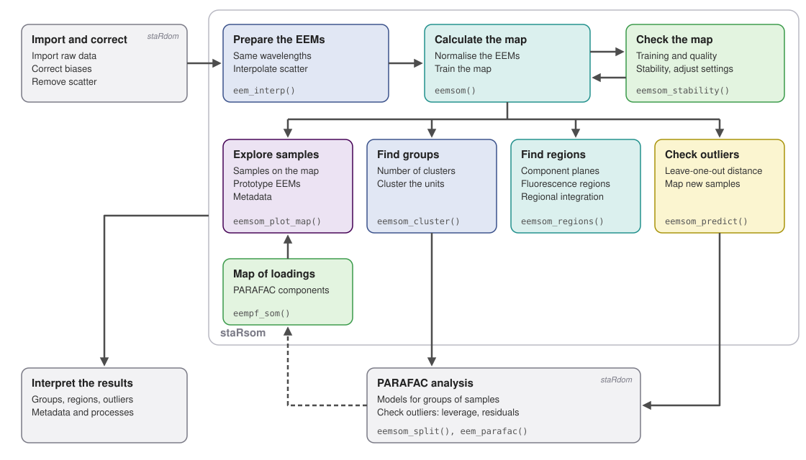

```{r, include = FALSE}
knitr::opts_chunk$set(
  collapse = TRUE,
  comment = "#>",
  fig.width = 7,
  fig.height = 5,
  out.width = "100%"
)
cores <- 2
```

{width=180}

# Introduction

staRsom is an add-on to staRdom [@pucher_stardom_2019]. It arranges excitation emission matrices (EEMs) of dissolved organic matter (DOM) on a self-organising map (SOM). You can use it to explore large and heterogeneous data sets, to find groups of samples with similar DOM, to find regions of the EEMs that behave alike and to identify unusual samples [@bieroza_exploratory_2009; @ejarque_som_2014]. staRsom works with the EEMs you have corrected with staRdom, so please do the corrections first (see the staRdom vignettes).

## Aim of this document

> This document shows a complete analysis of EEM data with a self-organising map, from the corrected EEMs to the interpretation of the map, and how the results can be used in a PARAFAC analysis.

## How a self-organising map works

You can think of a self-organising map as a grid of hexagonal cells, called units. Each unit holds a typical EEM, its prototype. During the training, each sample is compared with all prototypes. The most similar prototype and, to a lesser degree, its neighbours are shifted a little towards the sample. After many rounds, similar EEMs end up on the same or on neighbouring units and the prototypes change gradually across the map [@kohonen_essentials_2013]. The map is a two-dimensional picture of your data set: the position of a sample tells you what kind of EEM it has.

Unlike PARAFAC [@murphy_fluorescence_2013], the map does not assume that the EEMs are sums of independent components. It is therefore a good tool for exploring the data before or besides a PARAFAC analysis. staRsom follows the approach of Ejarque-Gonzalez and Butturini [-@ejarque_som_2014]:

* The EEMs are normalised, so the map shows differences in the shape of the EEMs, i.e. in the composition of DOM, rather than in the concentration.
* The prototypes are grouped by a cluster analysis to find groups of samples [@vesanto_clustering_2000].
* Wavelength pairs that change in the same way across the map are grouped into fluorescence regions.
* The stability of the map is tested by calculating it repeatedly from changed sample sets [@debodt_reliability_2002].

Alternatively, you can arrange the loadings of a PARAFAC model on a map [@cuss_ph_2014; @wheeler_senescence_2017]. The maps are calculated with the R package kohonen [@wehrens_kohonen_2018].

## Overview of analysis steps

The diagram below shows the steps of an analysis with staRsom. After importing and correcting the EEMs with staRdom, the EEMs are prepared and the map is calculated. You should check the training, the quality and the stability of the map and adjust the settings if necessary. Then you can explore the samples on the map, find groups of samples and fluorescence regions and check for outliers. Groups of samples can be analysed separately with PARAFAC in staRdom, and the loadings of a PARAFAC model can be arranged on a map as well.

{width=100%}

## Parallel processing

Some functions can use several CPU cores to speed up the calculations:

* `eem_interp()` of staRdom interpolates the EEMs in parallel.
* `eemsom()` and `eempf_som()` can train the map in parallel with `mode = "pbatch"`. This parallel batch algorithm gives slightly different maps than the default online training, so please use the same `mode` if you want to reproduce your results.
* `eemsom_stability()` calculates the repeated maps in parallel. Its results are the same regardless of the number of cores.

As in staRdom, we recommend setting `cores` to the number of physical cores of your computer:

```{r, eval = FALSE}
cores <- parallel::detectCores(logical = FALSE)
```

This vignette uses 2 cores.

## Remark on warnings

Some functions show warnings when something unusual happens, e.g. when a group of samples is too small for a PARAFAC model or when the map has more units than samples. Warnings do not stop the calculation. Please think about the reason of a warning; in some cases it is in line with what you want.

```{r setup, message = FALSE}
library(staRsom)
data(eem_list)
data(pf_models)
```

# Load and prepare the data

## Load the drEEM example data

The drEEM tutorial data set [@murphy_fluorescence_2013] contains `r nrow(pf4[[1]]$A)` samples after removing blanks and outliers. It is not part of staRdom or staRsom because of its size, but you can download it with `eem_load_dreem()` (see the staRdom vignette "PARAFAC analysis of EEM data"). The data is already corrected. Use the following code to work with the complete data set:

```{r, eval = FALSE}
# download the drEEM data set
eem_list <- eem_load_dreem()
# remove blanks and samples that were excluded in the drEEM tutorial
eem_list <- eem_exclude(eem_list, exclude = list(sample = eem_names(eem_list)[grepl("bl|0A", eem_names(eem_list))]))
```

To keep the calculation times of this vignette short, the small subset of `r length(eem_list)` samples from staRdom is used below. With so few samples, the map is very coarse and the results should not be interpreted. The code works the same way with the complete data set.

```{r}
eem_list
```

## Prepare the EEMs

All EEMs need the same excitation and emission wavelengths. We recommend removing and interpolating scattering as in a PARAFAC analysis, otherwise Raman and Rayleigh scattering would dominate the map. Here, the wavelengths are additionally reduced to the range of the PARAFAC model `pf4` from staRdom. These staRdom functions are useful at this step:

* `eem_range()` cuts the EEMs to a range of wavelengths.
* `eem_red2smallest()` and `eem_extend2largest()` bring EEMs with different wavelengths to the same wavelengths.
* `eem_rem_scat()` removes scattering, `eem_interp()` interpolates the removed areas.
* `eem_exclude()` removes samples or wavelengths.

```{r}
eem_list <- eem_list |>
  # same wavelength range as the PARAFAC model pf4
  eem_range(ex = c(250, 455), em = c(290, 578)) |>
  # remove Raman and Rayleigh scattering of 1st and 2nd order
  eem_rem_scat(remove_scatter = c(TRUE, TRUE, TRUE, TRUE), remove_scatter_width = c(15, 15, 18, 19)) |>
  # interpolate the removed areas
  eem_interp(type = 1, extend = FALSE, cores = cores)
ggeem(eem_list)
```

# Calculate the map

## Train the map

`eemsom()` normalises the EEMs and trains the map. By default, each EEM is divided by its standard deviation, like `eem_parafac(normalise = TRUE)` does, so the map shows differences in the composition of DOM. You can use `normalise = "max"` to divide by the maximum as Ejarque-Gonzalez and Butturini [-@ejarque_som_2014] did, or `normalise = "none"` if differences in concentration are of interest. The size of the map is chosen automatically from the number of samples [@vesanto_clustering_2000], but you can set it with `dim`. Please always set a `seed` to get the same map again.

```{r}
# train the map, the seed makes the result reproducible
som <- eemsom(eem_list, seed = 42, verbose = TRUE)
som
```

## Check the training and the quality

The training should end with a flat curve. If the curve still decreases at the end, please increase the number of training rounds `rlen`.

```{r, fig.height = 3}
eemsom_plot_training(som)
```

`eemsom_quality()` describes how well the map represents your samples:

* The quantisation error is the mean distance between the samples and their prototypes. Lower values mean that the prototypes represent the samples well.
* The topographic error is the share of samples whose two most similar prototypes are not neighbours. High values indicate a folded map, on which similar samples are spread over distant units.
* The explained variance is the share of the differences between the samples that is represented by the prototypes.

```{r}
eemsom_quality(som)
```

## Speed up the calculation for large data sets

With the 15 samples used here, every step takes seconds. The training time grows with the numbers of samples, units and wavelength pairs: the default online training with `rlen = 500` takes about a minute for 200 EEMs with 3000 wavelength pairs and several minutes for 1000 EEMs on one core. The stability test below repeats the training `nrep` times. To reduce the time, you can use the parallel batch training, fewer training rounds or a lower resolution of the EEMs. Ejarque-Gonzalez and Butturini [-@ejarque_som_2014] used 366 wavelength pairs.

```{r, eval = FALSE}
# parallel batch training with 4 cores and fewer training rounds
som_pbatch <- eemsom(eem_list, mode = "pbatch", cores = 4, rlen = 100, seed = 42)
# lower resolution: remove every second excitation and emission wavelength
eem_list_reduced <- eem_exclude(eem_list, list(ex = eem_list[[1]]$ex[c(FALSE, TRUE)], em = eem_list[[1]]$em[c(FALSE, TRUE)]))
```

# Explore the samples on the map

These functions show where the samples are and what the map looks like:

* `eemsom_samples()` returns the unit of each sample, its distance to the prototype, the number of samples on the unit (`hits`) and the U-matrix value of the unit (see below).
* `eemsom_plot_map()` shows different properties of the units and the samples on the map.
* `ggeem()` plots the prototype EEMs, `eemsom_codes()` returns them as an eemlist, e.g. for an export.
* `eemsom_plot_cplane()` shows the fluorescence of single wavelength pairs on the map.

## Locate the samples

```{r}
eemsom_samples(som)
```

The number of samples per unit shows how the samples are distributed. `unit_labels = TRUE` adds the numbers of the units, which are used in the other functions. The U-matrix shows how different each prototype is from its neighbours. High values mark borders between groups of similar units, low values indicate regions of similar units [@ejarque_som_2014].

```{r, fig.show = "hold", out.width = "48%", fig.width = 4, fig.height = 5}
eemsom_plot_map(som, type = "counts", unit_labels = TRUE)
eemsom_plot_map(som, type = "umatrix")
```

You can colour the samples by metadata, e.g. sampling site, date or discharge. Ejarque-Gonzalez and Butturini [-@ejarque_som_2014] showed in this way that samples taken during floods along the whole river were mapped to a few neighbouring units, i.e. floods made the EEMs more similar. Here, we use the first letters of the sample names as an example.

```{r, fig.height = 6}
# one value per sample, in the order of the samples in eem_list
site <- substr(eem_names(eem_list), 1, 3)
eemsom_plot_map(som, type = "samples", colour = site, labels = TRUE)
```

## View the prototype EEMs

The prototypes are arranged like the units on the map. The titles show the number of samples on each unit. The prototypes show the typical fluorescence of each part of the map [@ejarque_som_2014], so you can see how the EEMs change from one side of the map to the other.

```{r, fig.height = 8}
ggeem(som)
```

## Look at single wavelength pairs

A component plane shows the fluorescence of one wavelength pair in all prototypes. Wavelength pairs with similar component planes change in the same way across your samples, which is the basis of the fluorescence regions below [@ejarque_som_2014]. Here, we look at the peaks B, T, A and C [@coble_characterization_1996]. With one colour scale for all planes, you can compare the intensities:

```{r, fig.height = 6}
# peaks B, T, A and C, the closest available wavelengths are used
eemsom_plot_cplane(som, ex = c(275, 275, 260, 350), em = c(310, 340, 450, 450))
```

Scaling each plane from 0 to 1 shows the patterns of weak peaks as well:

```{r, fig.height = 6}
eemsom_plot_cplane(som, ex = c(275, 275, 260, 350), em = c(310, 340, 450, 450), scale = "each")
```

# Find groups of samples

The prototypes are grouped by a hierarchical cluster analysis with complete linkage [@ejarque_som_2014]. Each sample belongs to the cluster of its unit. These functions are used:

* `eemsom_kselect()` helps you to choose the number of clusters.
* `eemsom_cluster()` clusters the units.
* `eemsom_plot_silhouette()` shows how well each unit fits into its cluster.
* `eemsom_plot_map(type = "cluster")` shows the clusters on the map.

## Choose the number of clusters

`eemsom_kselect()` calculates several criteria for different numbers of clusters. Good numbers have a high mean silhouette width [@rousseeuw_silhouettes_1987], few units with negative silhouette widths (units that would fit better into another cluster), a low Davies-Bouldin index and are at a bend of the decreasing within-cluster sum of squares. The criteria do not always agree, so please also consider what makes sense for your samples.

```{r}
eemsom_kselect(som, k = 2:8)
```

## Cluster the units

The silhouette width shows how well each unit fits into its cluster. Ejarque-Gonzalez and Butturini [-@ejarque_som_2014] chose the number of fluorescence regions by a high mean silhouette width and few negative values.

```{r, fig.show = "hold", out.width = "48%", fig.width = 4, fig.height = 5}
# three clusters, complete linkage by default
som <- eemsom_cluster(som, k = 3)
eemsom_plot_map(som, type = "cluster")
eemsom_plot_silhouette(som)
```

```{r}
# number of samples per cluster
table(cluster = eemsom_samples(som)$cluster)
```

# Find fluorescence regions

Wavelength pairs whose component planes are correlated change in the same way across your samples. `eemsom_regions()` groups them into regions, and each region is assumed to represent a fluorescence component [@ejarque_som_2014]. By default, the number of regions is chosen from 2 to 9 by the highest mean silhouette width; you can also set a single number with `k`. The default `method = "planes"` is a fast alternative to the correlation matrix used by Barreto-Sanz and Pérez-Uribe [-@barreto_correlation_2007] (`method = "cormat"`). These functions are used:

* `eemsom_regions()` finds the regions.
* `ggeem()` plots the regions.
* `eemsom_fri()` integrates the fluorescence of each sample within the regions.

```{r}
regions <- eemsom_regions(som)
regions
# criteria for the numbers of regions
regions$kselect
ggeem(regions)
```

The fluorescence of each sample can be integrated within the regions [@chen_fri_2003]. Ejarque-Gonzalez and Butturini [-@ejarque_som_2014] used these area-normalised volumes as new variables to describe their samples. They describe your samples independently of a PARAFAC model.

```{r}
fri <- eemsom_fri(eem_list, regions)
fri
```

# Check the stability of the map

Before you interpret the map, please check whether it is stable. `eemsom_stability()` calculates the map again from changed sample sets with the settings of `som`: from bootstrap samples, i.e. samples drawn randomly with replacement [@debodt_reliability_2002], or from all samples but one (leave-one-out, `type = "loo"`) [@ejarque_som_2014]. On a stable map, pairs of samples are almost always or almost never neighbours, while a random map produces a bell-shaped distribution (compare Figure 4B in Ejarque-Gonzalez and Butturini [-@ejarque_som_2014]). More repetitions (`nrep`) give more reliable results. Each repetition trains a new map, so please consider the advice on calculation times above.

```{r}
# 10 maps from bootstrap samples, calculated in parallel
stab <- eemsom_stability(eem_list, som, nrep = 10, cores = cores)
stab
eemsom_plot_stability(stab)
```

# Check for outliers

## Keep outliers in the map

In a PARAFAC analysis, outliers are removed, because a few unusual samples can distort all components of the model [@murphy_fluorescence_2013]. Self-organising maps are less sensitive: each unit has its own prototype and an unusual sample usually occupies a unit of its own without changing the rest of the map. Ejarque-Gonzalez and Butturini [-@ejarque_som_2014] kept their outliers and found them "naturally integrated" in the map; industrial effluents formed clusters of single units, and leaving them out did not change the map in a meaningful way. Moreover, unusual samples are often an interesting result of an exploratory analysis. Therefore, we recommend keeping outliers in the map. Only samples with errors, e.g. measurement artefacts or remaining scatter, should be removed before.

## Find candidates for outliers

The map gives you hints on samples that might be outliers in a subsequent PARAFAC analysis. Here, the two samples excluded by staRdom from the drEEM data are added to the example data:

```{r}
# the two samples excluded by staRdom, prepared like the example data
data(eem_list_outliers)
eem_list_outliers <- eem_list_outliers |>
  eem_rem_scat(remove_scatter = c(TRUE, TRUE, TRUE, TRUE), remove_scatter_width = c(15, 15, 18, 19)) |>
  eem_interp(type = 1, extend = FALSE, cores = cores)
# example data and the two outliers together
eem_all <- eem_bind(eem_list, eem_list_outliers)
som_all <- eemsom(eem_all, seed = 42)
smp <- eemsom_samples(som_all)
```

Unusual samples often occupy a unit alone (`hits` = 1) that is separated from the neighbouring units by a high U-matrix value. Their distance to the prototype can be small though, because the prototype adapts to them. A more reliable indicator is the leave-one-out distance: each sample is compared with a map calculated without it. This is similar to the residuals of a sample that is not part of a PARAFAC model. `eemsom_stability()` with `type = "loo"` calculates these maps and returns the distances in the element `loo`.

```{r}
# one map without each sample
loo <- eemsom_stability(eem_all, som_all, type = "loo", nrep = 1, cores = cores)
loo
```

The table compares these indicators with the leverage of the samples in the PARAFAC model `pf2[[4]]` from staRdom, which contains all drEEM samples including the two outliers.

```{r}
outliers <- data.frame(smp[, c("sample", "hits", "umatrix", "distance")],
                       loo = loo$loo$distance,
                       leverage = unname(eempf_leverage(pf2[[4]])$A[smp$sample]))
# samples with the highest leave-one-out distances first
outliers[order(-outliers$loo), ]
```

```{r, fig.height = 6}
eemsom_plot_map(som_all, type = "samples", colour = loo$loo$distance, labels = TRUE)
```

The samples with the highest leave-one-out distances, `r paste(head(outliers$sample[order(-outliers$loo)], 2), collapse = " and ")`, are the two outliers. In the complete drEEM data set (208 samples including the two outliers, default settings), both samples occupied units of their own and had the highest leave-one-out distances (9.9 and 7.3, median of all samples 1.0, next sample 3.6) as well as the highest leverages in the PARAFAC model (0.49 and 0.26, next sample 0.08).

## Check the candidates in PARAFAC

The indicators of the map point to samples with an unusual shape of their EEMs. They do not replace the outlier analysis of the PARAFAC model:

* The leverage describes the influence of a sample on the PARAFAC model, the residuals describe how well the model represents the sample. The map cannot distinguish between both cases.
* Across all samples of the drEEM data, the indicators of the map were only moderately correlated with leverage and residuals (Spearman's correlation 0.37 to 0.54). The most extreme samples agreed, but not the order of the others.
* Samples that differ only in concentration are not detected, because the EEMs are normalised (unless `normalise = "none"`).

Please check samples with distinctly high leave-one-out distances with `eempf_leverage_plot()` and `eempf_residuals_plot()` of staRdom before you exclude them. Groups of single outliers created by `eemsom_split()` are too small for a PARAFAC model anyway.

# Continue the analysis

## Calculate PARAFAC models for groups of samples

You can analyse groups of samples separately with PARAFAC. `eemsom_split()` returns one eemlist per cluster. A warning is shown for groups with less than `min_samples` samples, because PARAFAC models need a sufficient number of samples. Please validate the PARAFAC model of each group as usual [@murphy_fluorescence_2013].

```{r}
# one eemlist per cluster
eem_groups <- eemsom_split(eem_list, som, min_samples = 5)
lengths(eem_groups)
```

```{r, eval = FALSE}
# one set of PARAFAC models per group
pf_groups <- lapply(eem_groups, eem_parafac, comps = 3:6, normalise = TRUE, nstart = 25, cores = cores)
```

## Map new samples

You can map new samples to an existing map, e.g. for monitoring. They need the same wavelengths and the same preparation as the samples of the map. Here, we use the two samples staRdom excluded as outliers from the drEEM data, which were prepared above.

```{r}
pred <- eemsom_predict(som, eem_list_outliers)
pred
```

A high distance compared to the samples of the map indicates that a sample is not well represented by the map. The distances of the two outliers (`r paste(round(pred$distance, 1), collapse = " and ")`) are much higher than those of the samples used to calculate the map (maximum `r round(max(eemsom_samples(som)$distance), 1)`).

# Calculate a map of PARAFAC loadings

Instead of the EEMs, you can arrange the loadings of a PARAFAC model on a map. Cuss et al. [-@cuss_ph_2014] found a clearer separation of DOM sources with the relative contributions of the components than with the EEMs. `eempf_som()` uses the Fmax values of each component, divided by their sum per sample (`normalise = TRUE`). Here, we use the six-component model of the complete drEEM data set from staRdom.

```{r}
# map of the relative contributions of the PARAFAC components
pfsom <- eempf_som(pf4[[1]], seed = 42)
pfsom
eemsom_quality(pfsom)
```

The component planes show the relative contribution of each PARAFAC component. Each plane is scaled individually to show the patterns of all components.

```{r, fig.height = 6}
eemsom_plot_cplane(pfsom, scale = "each")
```

You can use the functions for clustering, splitting and plotting as for maps of EEMs. The prototype EEMs are calculated from the PARAFAC components.

```{r, fig.show = "hold", out.width = "48%", fig.width = 4, fig.height = 6}
eemsom_kselect(pfsom, k = 2:8)
pfsom <- eemsom_cluster(pfsom, k = 4)
eemsom_plot_map(pfsom, type = "cluster")
eemsom_plot_map(pfsom, type = "counts")
```

```{r, fig.height = 4}
# prototypes of one unit per cluster
units <- which(!duplicated(pfsom$clusters))
ggeem(pfsom, units = units)
```

New samples are mapped after their loadings have been calculated with the emission and excitation loadings of the PARAFAC model (`A_missing()` of staRdom). They need the same preparation as the EEMs of the model. Here, the two outliers prepared above are used.

```{r}
eemsom_predict(pfsom, eem_list_outliers)
```

# Interpret the map

These points help you to read the map:

* **Position:** Samples close to each other on the map have similar EEMs. Distances on the map are only meaningful between neighbouring units; distant units can be similar if the map is folded.
* **U-matrix:** High values mark borders between groups of similar units. Groups of units with low values contain similar prototypes.
* **Counts and empty units:** Empty units lie between groups of samples and show transitions between them. Many samples on one unit indicate a homogeneous group.
* **Single units with high U-matrix values:** Samples with very distinctive EEMs can form clusters of a single unit, e.g. industrial effluents in Ejarque-Gonzalez and Butturini [-@ejarque_som_2014]. Such outliers are integrated in the map without distorting it, which you can check with the stability test. High leave-one-out distances confirm them as candidates for outliers in a PARAFAC analysis (see "Check for outliers").
* **Prototypes:** The prototype EEMs show the typical fluorescence of each part of the map. You can read the differences between clusters from their prototypes.
* **Component planes:** Similar component planes indicate fluorescence that changes in the same way. Gradients of peaks along the map explain the arrangement of the samples. The regions summarise these patterns.
* **Metadata:** Colouring the samples by metadata shows whether groups on the map correspond to sites, seasons, hydrological conditions or other factors.
* **Stability:** Please draw conclusions only from stable maps. Check the quality measures and the stability before you interpret single units.

# References
